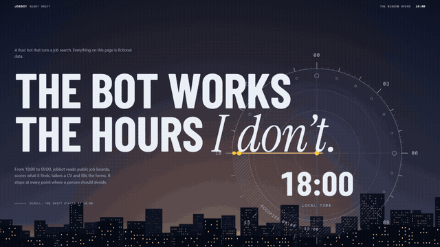
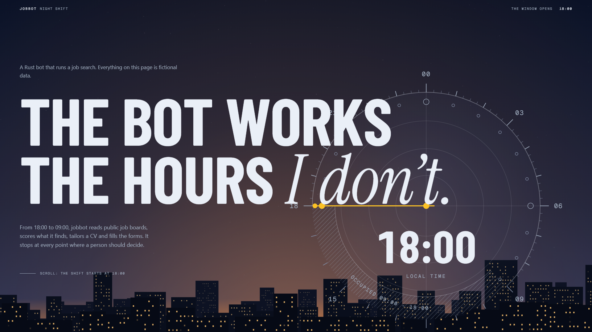
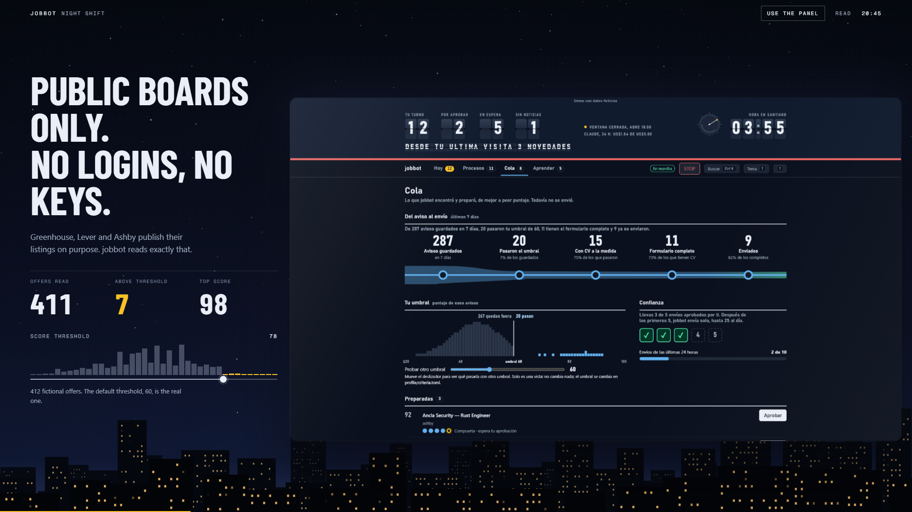

# The Night Shift

[](https://github.com/gonzalo-rosas-rojas/jobbot-showcase/actions/workflows/checks.yml)

**Live:** [gonzalo-rosas-rojas.github.io/jobbot-showcase](https://gonzalo-rosas-rojas.github.io/jobbot-showcase/) (desktop or phone)

[](https://gonzalo-rosas-rojas.github.io/jobbot-showcase/)

A scroll-driven walkthrough of **jobbot**, a Rust program that runs a job search between 18:00 and 09:00: it reads
public job boards, scores what it finds, tailors a CV, fills the forms, and stops at every point where a person
should decide. The page is the clock: scrolling moves the night from 18:00 to 09:00, through eight acts (the window
opens, read, decide, fill, the machine room, follow, approve, the window closes).

| The window opens (18:00) | Read: the real panel docked (20:45) | The window closes (08:56) |
|---|---|---|
|  |  |  |

*The GIF and the three stills are captures of this page at 1920x1080 (the GIF is scaled to 960x540, 20 fps, about 7 s of scroll).*

Everything on the page is fictional data. The few numbers about the code (lines, tests, dependencies) are counted
from the real repository by `scripts/receipts.py`, and the rules on the last screen each point at the file that
enforces them. The jobbot source is at [gonzalo-rosas-rojas/jobbot](https://github.com/gonzalo-rosas-rojas/jobbot).

At the end of the story, **Use the panel** opens the panel (the page a Rust server renders) as a live demo on
fictional data, growing out of the panel the story was showing. It moves the way the story does (a trip between
sections, a sun from the board's counters) and it has a keyboard layer: `1`-`5` switch section, `J`/`K` move through applications, `Enter` opens
one, `Esc` closes, `?` lists the keys.

**What the embedded demo is.** The panel in `site/demo/` is the demo build of the **current panel** with fictional data: it talks
to an in-page mock instead of a server, and it follows `?lang=es` or `?lang=en` (English when absent). The story moves it between
sections through its address (`#hoy`, `#cola`). It is replaced with `scripts/build-demo.py` (below).

## Run it

No build step and no dependencies: static files.

```
python scripts/serve.py          # http://127.0.0.1:8790, binds to localhost only, no caching
```

Open `http://127.0.0.1:8790/`. The demo panel alone is at `/demo/index.html?scenario=urgent`
(`calm`, `urgent`, `stop`, `empty`, `window`, `closed`, `stale` and `heavy` change the mood of the board). It has two themes
that share this page's palette: add `&theme=dark` or `&theme=light` (the story asks for the dark one).
The story itself takes `?lang=es` or `?lang=en` (English when absent) and passes it on to the panel it shows. The **ES | EN**
switch in the top bar marks the page's language and links to the other one, at the same point of the night. The Spanish text
lives in `site/assets/js/i18n.js`, as fixed strings applied before the scenes are built: no translation service and no request.

## Refresh the inputs

```
python scripts/receipts.py <path to the jobbot repo>                 # rewrites site/data/receipts.json
python scripts/build-demo.py <dir>/index.html <commit>   # copies a published demo build (its page and fonts/) into site/demo/ as it is
```

`build-demo.py` has **no default path on purpose**: the story depends on one specific panel build (the tab buttons the page clicks,
the elements the overlay looks at for `Esc`), so running it must never switch the piece to another version by accident. Whoever runs it
says which build it is, and gives the commit of the jobbot repository it was made from: the script writes it, with the UTC date of the copy, to
`site/demo/BUILD.txt`. The demo build itself is made by a script in the panel's development sources, which are not published (the public
jobbot repository ships only the built page, `src/panel/page.html`); that script swaps the panel's `fetch` calls for an
in-page mock with fictional data.

## What is in here

```
site/index.html          the eight acts, as plain semantic sections
site/assets/css/main.css one stylesheet: tokens, type voices, every act, the narrow-screen block
site/assets/js/          engine (scroll), rig (3D panel plane + dial), sky (canvas), try (live demo overlay), lang (?lang= handed to the panel), i18n (the Spanish story and the ES | EN switch),
                         camera (zoom for the two diagrams: phones, and a window on wide screens), scenes/ (one module per act)
site/assets/fonts/       the three type voices as subset woff2 files, with their licences and where they came from (VENDORED.md)
site/demo/               the current panel's published demo build, with fictional data, and its fonts/ with their licences
site/data/receipts.json  the counted numbers
tests/                   the checks (below), plain node:test, no packages
docs/DESIGN.md           why it looks and moves the way it does
docs/hero.gif, docs/shot-*.png   the captures at the top of this file
```

No framework, no CDN, no images: the page ships its own strict Content-Security-Policy
(`default-src 'none'; script-src 'self'; style-src 'self'; img-src 'self' data:; media-src 'self'; frame-src 'self'; font-src 'self'; connect-src 'self'; base-uri 'none'; form-action 'none'`),
so it also runs from any static host and asks nothing from any other origin. The policy is a `<meta>` tag because GitHub Pages does not let a
repository set response headers; a `<meta>` policy cannot declare `frame-ancestors`, so the page cannot forbid being framed (see `SECURITY.md`).

## Checks

```
node --test          # from the repository root; Node 20 or later, no packages
```

Two groups, both in `tests/`:

- **Static** (`static.test.mjs`, `build-demo.test.mjs`): every file the page refers to exists; nothing the page loads comes from another origin; the
  Content-Security-Policy is the one described above and the markup does not break it (no inline script, `style` attribute or event handler);
  every font matches the sha256 in `VENDORED.md`; `receipts.json` has the fields the story reads; `index.html` preloads exactly the modules
  the import graph needs; the first load stays under a weight budget; the demo build record is written correctly.
- **Browser** (`browser.test.mjs`): a headless Chrome, started with its own temporary profile and no open port, scrolls the whole story in English
  and Spanish (and in English on a phone) and fails on any console error or warning, including a Spanish text that no longer matches the page, and on any
  request to another origin; checks that the panel is requested only after the page has loaded and is never shown empty; checks what `docs/DESIGN.md`
  says about reduced motion; and checks that the page reads as a document with JavaScript off. Set `CHROME_PATH` if Chrome is not in a usual place;
  without Chrome these tests are skipped with a message, and `SHOWCASE_REQUIRE_BROWSER=1` turns that into a failure (the workflow sets it).

The same checks run on every push and pull request (`.github/workflows/checks.yml`), and the site is published only when they pass.
Add `?qa=1` to the address to get the testing hook `window.__night` and development warnings in the console.

## Fonts

Three own faces, all SIL Open Font License 1.1, served from `site/assets/fonts/`: Barlow Condensed 700 (condensed headlines),
Instrument Serif Italic (the one italic word of a headline) and Geist Mono 400 (the instruments). 53 KB in total. The OFL texts and the
origin and sha256 of every file are in `site/assets/fonts/VENDORED.md`. The system faces the piece used first (Bahnschrift, Palatino,
Cascadia) stay behind them as fallbacks.

## License and hosting

The code and copy are MIT-licensed (see `LICENSE`); the fonts keep their own OFL licenses.

`.github/workflows/pages.yml` publishes the `site/` folder to https://gonzalo-rosas-rojas.github.io/jobbot-showcase/ on every push
to `main`; its actions are pinned to commit SHAs. A fork publishes the same way once its Settings, Pages, Source is set to
GitHub Actions.

## Author

Built by Gonzalo Rosas Rojas, full-stack and AI engineer, Santiago, Chile (remote).
[linkedin.com/in/gonzalo-rosas-rojas](https://www.linkedin.com/in/gonzalo-rosas-rojas)

The page was designed and written with Claude Code (Anthropic) as a pair-programming partner; the direction, the story and the
decisions are the author's, and every number on the page is counted from the real code by `scripts/receipts.py`.
