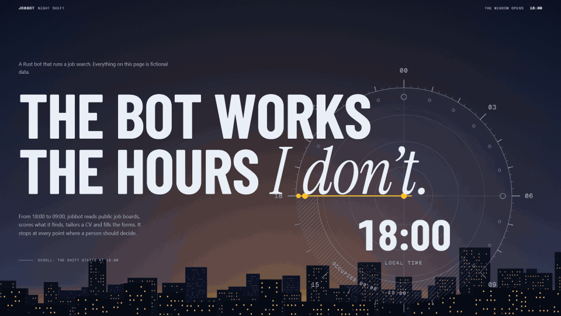
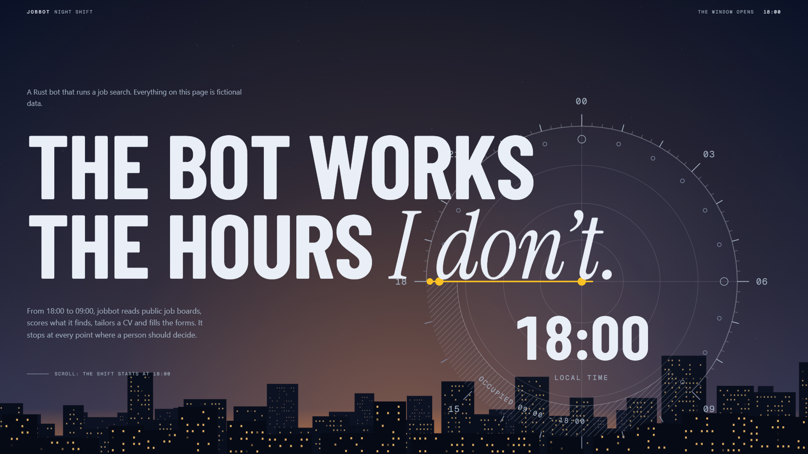
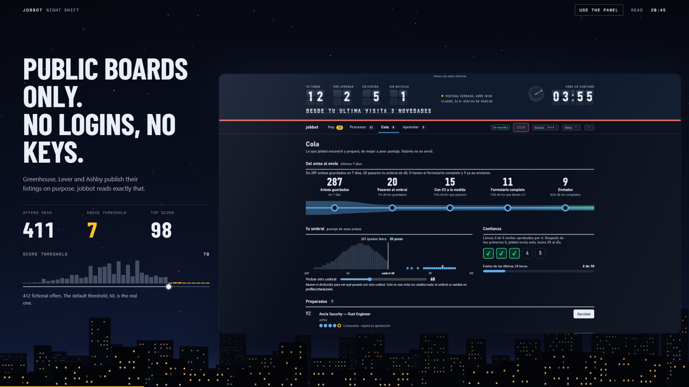
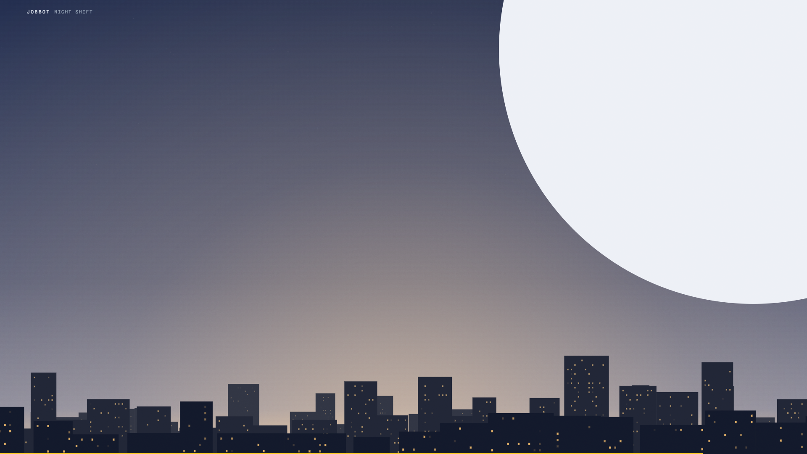

# The Night Shift



A scroll-driven walkthrough of **jobbot**, a Rust program that runs a job search between 18:00 and 09:00: it reads
public job boards, scores what it finds, tailors a CV, fills the forms, and stops at every point where a person
should decide. The page is the clock: scrolling moves the night from 18:00 to 09:00, through eight acts (the window
opens, read, decide, fill, the machine room, follow, approve, the window closes).

| The window opens (18:00) | Read: the real panel docked (20:45) | The window closes (08:56) |
|---|---|---|
|  |  |  |

*The GIF and the three stills are captures of this page at 1920x1080 (the GIF is scaled to 960x540, 20 fps, about 7 s of scroll).*

Everything on the page is fictional data. The few numbers about the code (lines, tests, dependencies) are counted
from the real repository by `scripts/receipts.py`, and the rules on the last screen each point at the file that
enforces them. The jobbot source is at [GonzaloRosas/jobbot](https://github.com/GonzaloRosas/jobbot).

At the end of the story, **Use the panel** opens the panel (the page a Rust server renders) as a live demo on
fictional data, growing out of the panel the story was showing. It moves the way the story does (a trip between
sections, a sun from the board's counters) and it has a keyboard layer: `1`-`4` switch section, `J`/`K` move through applications, `Enter` opens
one, `Esc` closes, `?` lists the keys.

**What the embedded demo is.** The panel in `site/demo/` is the **panel v1** build with fictional data: its interface is in Spanish,
it talks to an in-page mock instead of a server, and it does not read `?lang=`. It is not the current panel. A newer build
can replace it with `scripts/build-demo.py` (below) when that is decided.

## Run it

No build step and no dependencies: static files.

```
python scripts/serve.py          # http://127.0.0.1:8790, binds to localhost only, no caching
```

Open `http://127.0.0.1:8790/`. The demo panel alone is at `/demo/index.html?scenario=urgent`
(`calm`, `urgent`, `stop`, `empty` and `window` change the mood of the board). It has two themes that share this
page's palette: add `&theme=dark` or `&theme=light`, or press `T` inside it (the story asks for the dark one).
The story itself takes `?lang=es` or `?lang=en` (English when absent) and passes it on to the panel it shows; the v1 panel that ships
here ignores it and stays in Spanish, a build that reads `?lang=` will follow.

## Refresh the inputs

```
python scripts/receipts.py <path to the jobbot repo>                 # rewrites site/data/receipts.json
python scripts/build-demo.py <path to panel docs/demo/index.html>    # copies that demo build into site/demo/ as it is
```

`build-demo.py` has **no default path on purpose**: the story depends on one specific panel build (the tab buttons the page clicks,
the elements the overlay looks at for `Esc`), so running it must never switch the piece to another version by accident. Whoever runs it
says which build it is. The demo build itself comes from the panel's own repository (`node scripts/build-demo.mjs`), which swaps the
panel's `fetch` calls for an in-page mock with fictional data.

## What is in here

```
site/index.html          the eight acts, as plain semantic sections
site/assets/css/main.css one stylesheet: tokens, type voices, every act, the narrow-screen block
site/assets/js/          engine (scroll), rig (3D panel plane + dial), sky (canvas), try (live demo overlay), lang (?lang= handed to the panel),
                         camera (zoom for the two diagrams: phones, and a window on wide screens), scenes/ (one module per act)
site/assets/fonts/       the three type voices as subset woff2 files, with their licences and where they came from (VENDORED.md)
site/demo/               the panel v1 build, with fictional data
site/data/receipts.json  the counted numbers
docs/DESIGN.md           why it looks and moves the way it does
docs/hero.gif, docs/shot-*.png   the captures at the top of this file
```

No framework, no CDN, no images: the page ships its own strict Content-Security-Policy
(`default-src 'none'; script-src 'self'; style-src 'self'; img-src 'self' data:; media-src 'self'; frame-src 'self'; font-src 'self'; connect-src 'self'`),
so it also runs from any static host and asks nothing from any other origin.

## Fonts

Three own faces, all SIL Open Font License 1.1, served from `site/assets/fonts/`: Barlow Condensed 700 (condensed headlines),
Instrument Serif Italic (the one italic word of a headline) and Geist Mono 400 (the instruments). 53 KB in total. The OFL texts and the
origin and sha256 of every file are in `site/assets/fonts/VENDORED.md`. The system faces the piece used first (Bahnschrift, Palatino,
Cascadia) stay behind them as fallbacks.

## License and hosting

The code and copy are MIT-licensed (see `LICENSE`); the fonts keep their own OFL licenses.

`.github/workflows/pages.yml` publishes the `site/` folder to GitHub Pages on every push to `main`. Turn it on once under
Settings, Pages, Source: GitHub Actions. Its actions are pinned to commit SHAs.

## Author

Built by Gonzalo Rosas Rojas, full-stack and AI engineer, Santiago, Chile (remote).
[linkedin.com/in/gonzalo-rosas-rojas](https://www.linkedin.com/in/gonzalo-rosas-rojas)

The page was designed and written with Claude Code (Anthropic) as a pair-programming partner; the direction, the story and the
decisions are the author's, and every number on the page is counted from the real code by `scripts/receipts.py`.
